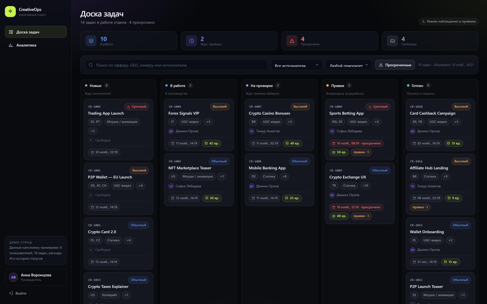
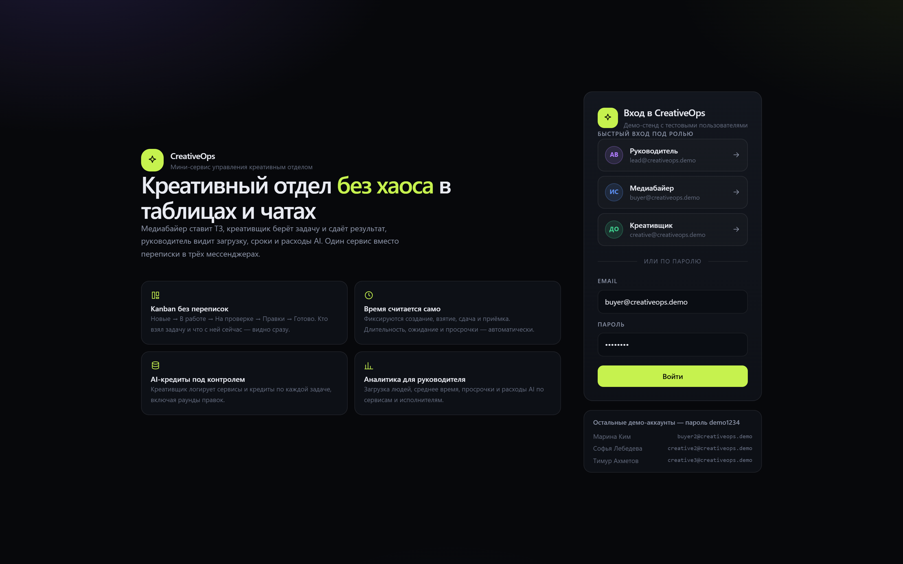
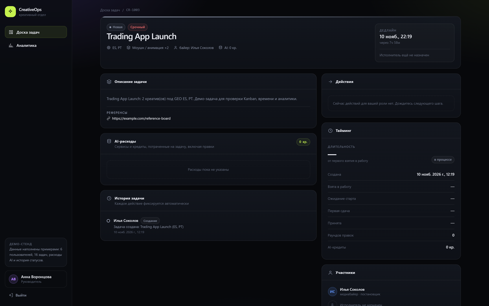
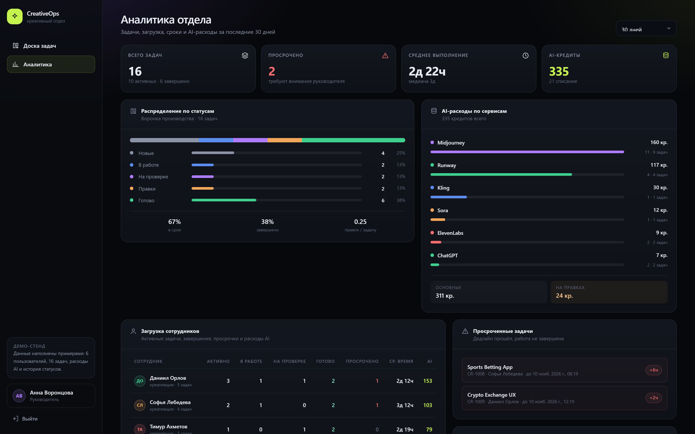
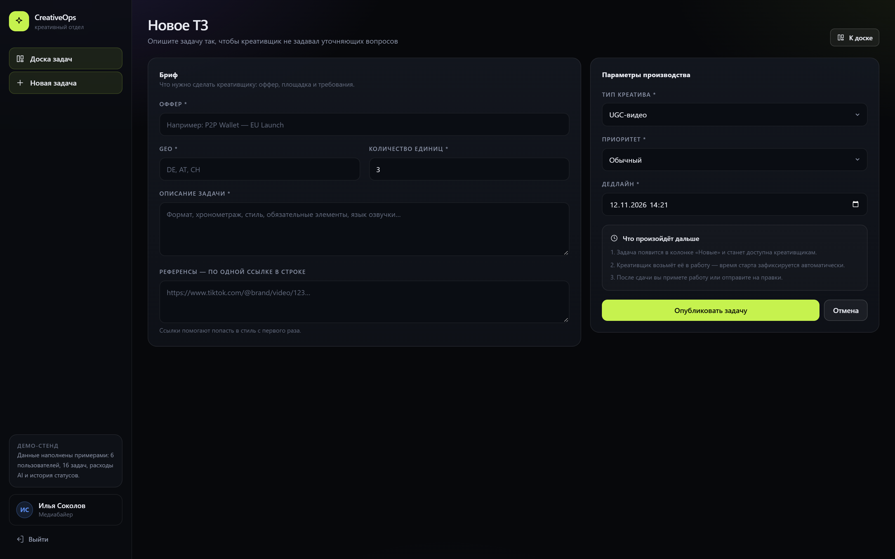

# CreativeOps

Мини-сервис управления креативным отделом: медиабайер ставит ТЗ, креативщик берёт задачу и сдаёт результат, руководитель видит загрузку, сроки и расходы AI.

**Стек:** Next.js 15 (App Router) · React 19 · TypeScript · Tailwind CSS 4 · SQLite (`node:sqlite`) · Vitest · Playwright.



---

## Быстрый старт

Нужен **Node.js 22.5+** (используется встроенный `node:sqlite`, нативных зависимостей нет).

```bash
npm ci
npm run dev
```

Откройте http://localhost:3000 — база создастся автоматически в `data/app.db` и наполнится демо-данными (6 пользователей, 16 задач во всех статусах, история, AI-расходы).

Production-режим:

```bash
npm run build
npm run start
```

### Демо-доступы

Пароль у всех аккаунтов — `demo1234`. На странице входа есть кнопки быстрого входа под тремя ролями.

| Роль | Email | Кто |
|---|---|---|
| Руководитель | `lead@creativeops.demo` | Анна Воронцова |
| Медиабайер | `buyer@creativeops.demo` | Илья Соколов |
| Медиабайер | `buyer2@creativeops.demo` | Марина Ким |
| Креативщик | `creative@creativeops.demo` | Даниил Орлов |
| Креативщик | `creative2@creativeops.demo` | Софья Лебедева |
| Креативщик | `creative3@creativeops.demo` | Тимур Ахметов |

---

## Что реализовано

- **Роли и RBAC.** Байер создаёт ТЗ; креативщик берёт задачу, сдаёт результат и логирует AI-кредиты; руководитель принимает работу и видит аналитику. Права проверяются в сервисном слое, а не только скрытием кнопок в UI.
- **Kanban.** Пять колонок: Новые → В работе → На проверке → Правки → Готово. Переходы возможны только через разрешённые действия (state machine), поэтому история и статус не расходятся.
- **Работа с задачей.** Взятие в работу, сдача с ссылкой на результат и комментарием, приёмка или возврат на правки с обязательным комментарием. Правки возвращаются тому же исполнителю.
- **Учёт времени.** Автоматически фиксируются создание, первое взятие, сдача и завершение. Считаются длительность, время до старта, время на проверке/правках и просрочка.
- **AI-расходы.** Сервис, количество кредитов, фаза (`initial` / `revision`), автор и комментарий. Агрегаты по задаче, сервису и исполнителю.
- **Аналитика руководителя.** KPI (всего/активные/завершённые/просроченные), воронка по статусам, среднее и медианное время выполнения, on-time rate, загрузка сотрудников, AI-кредиты по сервисам и людям, список просрочек.
- **История действий.** Append-only аудит: кто, что, когда, из какого статуса в какой. Отображается в карточке задачи.
- **Демо-данные.** 16 задач во всех статусах, включая просроченные, с правками, историей и расходами AI.

### Скриншоты

| Вход | Карточка задачи |
|---|---|
|  |  |

| Аналитика | Форма ТЗ |
|---|---|
|  |  |

---

## Архитектура

```
Браузер (React 19, server components + client islands)
        │ fetch / навигация
        ▼
Next.js Route Handlers ──► Services (use-cases, RBAC, транзакции) ──► Repositories (SQL)
   (auth, zod, JSON)                    │                                  │
                              Domain (чистые правила)                 SQLite (data/app.db)
                        статусы, права, время, агрегаты
```

Правило зависимостей: `app → services → {domain, db}`. Домен не знает про БД и HTTP, поэтому бизнес-правила тестируются мгновенно и детерминированно.

Ключевое решение: **статус меняется только через `applyAction()`** — единственное место, где одновременно пишутся статус, таймстемпы и запись в `activity`. Аудит является побочным эффектом единственно возможного пути, а не отдельной «дорисовкой».

### Модель данных

`users`, `sessions`, `tasks`, `ai_usage`, `activity`. Таймстемпы задач append-only (`first_started_at`, `first_submitted_at`, `submitted_at`, `completed_at`), история не удаляется. Подробнее — [`docs/02-ARCHITECTURE.md`](docs/02-ARCHITECTURE.md).

### API

| Метод | Путь | Назначение |
|---|---|---|
| POST | `/api/auth/login` | вход, httpOnly-cookie сессия |
| POST | `/api/auth/logout` | выход |
| GET | `/api/auth/me` | текущий пользователь |
| GET | `/api/tasks` | список с фильтрами (`status`, `assigneeId`, `q`, `priority`, `overdue`) |
| POST | `/api/tasks` | создать ТЗ (buyer) |
| GET | `/api/tasks/:id` | задача + история + AI-расходы + тайминги |
| POST | `/api/tasks/:id/actions` | `take` / `submit` / `approve` / `request_revision` |
| POST | `/api/tasks/:id/ai-usage` | добавить запись о кредитах |
| GET | `/api/analytics` | KPI, загрузка, просрочки, расходы (manager) |
| GET | `/api/meta` | справочники |

Единый формат ошибок: `{ "error": { "code": "...", "message": "..." } }` с HTTP-кодами `400/401/403/404/409/422`.

---

## Тесты

Тесты писались **до** кода. Сначала был зафиксирован красный прогон (модулей ещё нет), затем реализация доводилась до зелёного. Тесты не ослаблялись: единственная правка по ходу — корректные подписи статусов в UI (на карточке «Новая», в колонке «Новые»), а не изменение ожиданий.

```bash
npm test          # 122 теста: unit + integration + API
npm run test:e2e  # 10 Playwright-сценариев (нужен npm run build)
npm run verify    # typecheck + tests + build
```

| Уровень | Что проверяется |
|---|---|
| Unit | матрица переходов 5×4, права ролей, длительности/просрочка, агрегаты аналитики |
| Integration | полный жизненный цикл на реальной SQLite, RBAC-отказы, аудит, цифры аналитики, seed |
| API | коды ответов, cookie-сессия, валидация, запрет мутаций без авторизации |
| E2E | вход, создание ТЗ, взятие, сдача, правки, повторная сдача, приёмка, AI-кредиты, аналитика |

Текущий статус: **122/122** unit/integration/API и **10/10** E2E.

---

## Деплой

### Docker

```bash
docker build -t creativeops .
docker run -p 3000:3000 -v creativeops-data:/app/data creativeops
```

### Render

В репозитории есть `render.yaml`. Создайте Blueprint из репозитория — сервис соберётся по Dockerfile. На бесплатном плане файловая система эфемерна: при рестарте БД пересоздастся и заново наполнится демо-данными (для демо это нормально).

Переменные окружения:

| Переменная | По умолчанию | Назначение |
|---|---|---|
| `APP_DB_PATH` | `data/app.db` | путь к файлу SQLite |
| `SEED_DEMO` | `true` | `false` — не наполнять пустую БД демо-данными |

### Локальный публичный доступ

Если нужен временный публичный URL без хостинга:

```bash
npm run build && npm run start
# в другом терминале
npx localtunnel --port 3000
```

---

## Структура проекта

```
src/
  app/                 # страницы (RSC) и Route Handlers
    (app)/board/       # Kanban
    (app)/tasks/new/   # форма ТЗ
    (app)/tasks/[id]/  # карточка: действия, время, AI, история
    (app)/analytics/   # дашборд руководителя
    api/               # HTTP API
  components/          # UI-компоненты
  lib/
    db/                # node:sqlite, схема, репозитории
    domain/            # чистые правила: статусы, права, время, агрегаты
    services/          # use-cases, RBAC, транзакции
    seed.ts            # демо-данные
tests/
  unit/ integration/ api/ e2e/
docs/                  # research, архитектура, roadmap, AI-usage
```

---

## Осознанно вне скоупа прототипа

Загрузка файлов в S3 (вместо ссылки на результат), realtime/уведомления, биллинг и ставки, мультитенантность, SSO, drag-and-drop с оптимистичным UI, экспорт отчётов. Это зафиксировано, чтобы границы прототипа были явными.

---

## Документация

- [`docs/01-RESEARCH.md`](docs/01-RESEARCH.md) — декомпозиция ТЗ, сравнение стека, риски.
- [`docs/02-ARCHITECTURE.md`](docs/02-ARCHITECTURE.md) — слои, модель данных, state machine, RBAC, API.
- [`docs/03-ROADMAP.md`](docs/03-ROADMAP.md) — план работ по шагам и что дальше.
- [`docs/05-AI-USAGE.md`](docs/05-AI-USAGE.md) — какие AI-инструменты использовались и как организована работа.